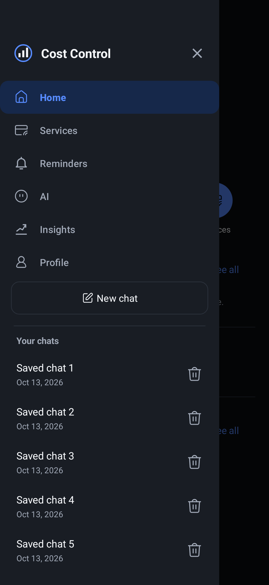

# Shared sidebar navigation

13 October 2026. This supersedes the bottom navigation and combined AI root in the earlier mobile navigation proposal.

## Layout

Keep the existing dark palette, native typography and 48 dp action targets. The screen header has a menu button and the current destination title. On phones the menu opens a native start-edge drawer, at most 320 dp wide, with a dimmed backdrop and a close action. It follows the layout direction for right-to-left locales.

The sidebar presents Home, Services, Reminders, AI, Insights and Profile as six peer destinations. AI opens Chat. Keep these above New chat and the Your chats section. Chat and Insights each occupy the content area without a subview toggle or duplicate chat toolbar. A checked menu item identifies the current destination.

History scrolls independently of navigation, showing saved titles and local dates. Load more chats reads the next bounded page of 25 conversations until all saved sessions are reachable. On short screens, the navigation menu can also scroll within its own bounded area so it cannot consume the entire history section. The history heading stays above its scroll area; status, retry and pagination controls remain reachable inside it.

Delete controls share the vector geometry from the user-supplied `IconTrashCan.svg`. History uses the supporting-text tint; Delete service and Delete reminder use the existing danger tint and retain their text labels and confirmation flows.

## Behavior and ownership

`MainActivity` owns destinations, the drawer and authentication/task guards. `AiChatView` supplies an embeddable history panel and coordinates its existing repository reads, selection, save retries and deletion. The shell can host history while a different root is visible. Opening a saved conversation returns to Chat; New chat creates an empty composer and keeps earlier saved sessions accessible. Neither action sends a model request.

Back and the close button dismiss the sidebar before navigating away. Opening it hides the keyboard while retaining the composer draft. System and keyboard insets leave the composer above the keyboard. Authentication and detail/form tasks lock the sidebar closed, preserving the existing form-discard and pending-write contracts.

Switching destinations preserves the Chat instance, drafts and conversation state. Root lists retain their own scroll/filter/query state. Activity recreation restores the selected destination and bounded chat state. Saved state from the former AI root maps to Chat or Insights; its five-entry scroll array maps to the new destinations without assigning Profile's position to Insights.

History reads retain their account-bound scope and stale-result guards. Closing the sidebar cancels acceptance of outstanding list/selection results. Saved entries remain cached across ordinary reopening; successful saves and deletions mark the list for refresh. A failed history request has an explicit retry, an empty account has an empty state, and deleting a conversation still requires confirmation. Sign-out or account switching disposes the Chat view and removes its history panel.

The backend, Supabase schema, authorization and model-context contract are unchanged. Saved history remains display-only. No new production dependency is needed: the existing Material library supplies the native navigation and drawer primitives.

## Verified preview

The preview uses an in-memory test account and fictional conversation titles.

